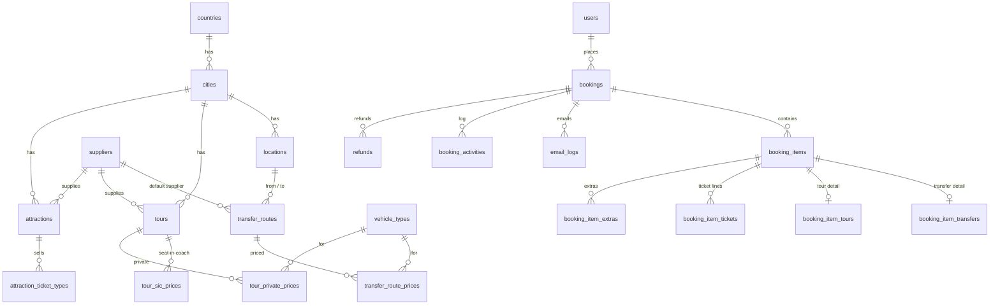

# MyTransferTours — Database Design

Laravel 11/12 · MySQL 8 (or MariaDB 10.6+) · all money stored as `DECIMAL(12,2)` in the product's currency (MYR at launch).

## Principles

1. **Global-ready from day one.** Every product hangs off a `city`, every city off a `country` that carries its currency and timezone. Launching Thailand later is data entry, not a migration.
2. **Cost and selling price on every price row.** Margin is always computable. Suppliers only ever see cost.
3. **Snapshots on bookings.** A booking copies titles, supplier name/email and prices at the moment of payment, so editing a product or supplier later never changes a past booking or a sent email.
4. **One booking, many items.** A booking is the cart that was paid; each item (transfer, tour, ticket) has its own supplier, status, confirmation token and emails.
5. **Stripe is the source of truth for payment.** A booking becomes `paid` only from the `checkout.session.completed` webhook, recorded idempotently in `stripe_events`.

## Entity overview

## Tables

### Geography

| Table | Key columns |
|---|---|
| `countries` | `code` (MY), `name`, `currency` (MYR), `phone_code`, `is_active` |
| `cities` | `country_id`, `name`, `slug`, `timezone` (Asia/Kuala_Lumpur), `is_active`, `sort` |
| `locations` | `city_id`, `name` (KL International Airport), `short_name` (KLIA), `type` (airport · city_area · hotel_zone · port · station · attraction · other), `iata_code`, `address`, `lat`, `lng`, `requires_flight_number`, `requires_address`, `is_active`, `sort` |

Admin adds pick-up / drop-off options in **Locations**. `requires_flight_number` makes the flight field mandatory when an airport is picked; `requires_address` asks for the hotel/address when a city area is picked.

### Suppliers

| Table | Key columns |
|---|---|
| `suppliers` | `name`, `contact_name`, `email`, `cc_emails` (json), `phone`, `whatsapp`, `bank_details` (encrypted text), `payment_terms`, `notes`, `is_active` |

### Vehicles

| Table | Key columns |
|---|---|
| `vehicle_types` | `name` (Standard sedan), `slug`, `description`, `example_models` (Toyota Vios or similar), `max_pax`, `max_bags`, `image`, `features` (json), `is_active`, `sort` |

### Transfers

| Table | Key columns |
|---|---|
| `transfer_routes` | `from_location_id`, `to_location_id`, `supplier_id`, `distance_km`, `duration_minutes`, `is_bidirectional`, `free_waiting_minutes`, `cancellation_hours`, `is_active` |
| `transfer_route_prices` | `transfer_route_id`, `vehicle_type_id`, `supplier_id` (nullable override), `cost_price`, `selling_price`, `currency`, `valid_from`, `valid_to`, `is_active` |

Price is per vehicle. Different suppliers per vehicle class are supported through the override.

### Tours

| Table | Key columns |
|---|---|
| `tours` | `city_id`, `supplier_id`, `title`, `slug`, `summary`, `description`, `highlights`/`itinerary`/`inclusions`/`exclusions` (json), `duration_minutes`, `has_sic`, `has_private`, `sic_departure_times` (json, e.g. ["08:30"]), `private_start_times` (json), `child_age_from`, `child_age_to`, `min_pax`, `cancellation_hours`, `images` (json), `is_active`, `sort` |
| `tour_sic_prices` | `tour_id`, `pax_type` (adult · child), `cost_price`, `selling_price`, `currency`, `valid_from`, `valid_to` — **per person** |
| `tour_private_prices` | `tour_id`, `vehicle_type_id`, `cost_price`, `selling_price`, `currency`, `valid_from`, `valid_to` — **per vehicle** |

### Attraction tickets

| Table | Key columns |
|---|---|
| `attractions` | `city_id`, `supplier_id`, `title`, `slug`, `summary`, `description`, `good_to_know` (json), `closed_weekdays` (json, e.g. [1] = Monday), `is_refundable`, `cancellation_hours`, `delivery_method` (instant_voucher · supplier_eticket), `images` (json), `is_active`, `sort` |
| `attraction_ticket_types` | `attraction_id`, `name` (Adult · Child · Malaysian MyKad), `age_label` (13+), `requires_id`, `cost_price`, `selling_price`, `currency`, `is_active`, `sort` |

### Shared catalogue tools

| Table | Key columns |
|---|---|
| `extras` | `product_type` (transfer · tour), `name` (Child seat), `cost_price`, `selling_price`, `max_quantity`, `is_active` — add-ons offered in the booking form |
| `blackout_dates` | polymorphic `bookable_type`/`bookable_id`, `date`, `reason` — public holidays, closures, sold-out days |
| `pricing_rules` | `name`, `product_type` (nullable = all), polymorphic `bookable_type`/`bookable_id` (nullable = all products of that type), `rule_type` (weekday · date_range · time_range), `weekdays` (json), `date_from`, `date_to`, `time_from`, `time_to`, `adjustment_type` (percent · fixed), `adjustment_value`, `applies_to` (selling · cost · both), `priority`, `is_active` |
| `coupons` | `code`, `type` (percent · fixed), `value`, `min_order_amount`, `max_uses`, `max_uses_per_user`, `used_count`, `starts_at`, `ends_at`, `is_active` |

`pricing_rules` is the dynamic-pricing engine: weekend +RM 12, peak dates (CNY, Hari Raya) +15 %, night surcharge 00:00–06:00 +RM 30 on transfers, all without touching base prices.

### Customers

`users` (Laravel default) gains: `google_id`, `avatar`, `phone`, `country_code`, `role` (customer · admin · staff), `marketing_opt_in`, `last_login_at`. Google login via Laravel Socialite; email login via Laravel Breeze/Fortify with verification.

### Cart

| Table | Key columns |
|---|---|
| `carts` | `user_id` (nullable), `session_id`, `currency`, `coupon_id`, `expires_at` |
| `cart_items` | `cart_id`, `product_type`, `product_id`, `service_date`, `service_time`, `payload` (json: everything the customer chose), `quoted_cost`, `quoted_price`, `quoted_at` |

Prices are re-calculated at checkout; the quote is only a display snapshot.

### Bookings

| Table | Key columns |
|---|---|
| `bookings` | `reference` (MTT-10482, unique), `user_id` (nullable for guests), `lead_first_name`, `lead_last_name`, `email`, `phone`, `country_code`, `currency`, `subtotal`, `discount_total`, `total`, `cost_total`, `coupon_id`, `coupon_code`, `status`, `stripe_checkout_session_id`, `stripe_payment_intent_id`, `stripe_charge_currency`, `stripe_charge_amount`, `stripe_fee`, `paid_at`, `cancelled_at`, `customer_notes`, `internal_notes`, `locale`, `ip_address`, soft deletes |
| `booking_items` | `booking_id`, `reference` (MTT-10482-T1), `product_type` (transfer · tour · attraction), polymorphic `bookable_type`/`bookable_id` (the route, tour or attraction), `title`, `service_date`, `service_time`, `supplier_id`, `supplier_name`, `supplier_email`, `cost_total`, `selling_total`, `status`, `supplier_token_hash`, `supplier_sent_at`, `supplier_confirmed_at`, `supplier_rejected_at`, `supplier_reference`, `supplier_notes`, `reminder_count`, `last_reminder_at`, `cancellation_deadline`, `voucher_path`, `eticket_path` |
| `booking_item_transfers` | `booking_item_id`, `pickup_location_id`, `dropoff_location_id`, `pickup_location_name`, `dropoff_location_name`, `pickup_address`, `dropoff_address`, `vehicle_type_id`, `vehicle_type_name`, `flight_number`, `flight_arrival_at`, `adults`, `children`, `infants`, `bags`, `sign_name`, `driver_notes`, `is_return_leg`, `paired_item_id`, `driver_name`, `driver_phone`, `vehicle_plate` |
| `booking_item_tours` | `booking_item_id`, `option` (sic · private), `vehicle_type_id`, `vehicle_type_name`, `adults`, `children`, `start_time`, `pickup_hotel`, `pickup_address` |
| `booking_item_tickets` | `booking_item_id`, `attraction_ticket_type_id`, `ticket_type_name`, `quantity`, `unit_cost`, `unit_price` |
| `booking_item_extras` | `booking_item_id`, `extra_id`, `name`, `quantity`, `unit_cost`, `unit_price` |

**Booking status:** `pending_payment` → `paid` → `confirmed` (all items confirmed) → `completed`; or `cancelled`, `refunded`, `partially_refunded`, `payment_failed`.

**Item status:** `pending` → `sent_to_supplier` → `confirmed` / `rejected` → `completed`; or `cancelled`.

### Emails, audit and payments

| Table | Key columns |
|---|---|
| `email_templates` | `key` (customer_confirmation · supplier_new_booking · supplier_reminder · supplier_cancellation · customer_cancellation), `name`, `subject`, `body` (Markdown with `{{placeholders}}`), `is_active` |
| `email_logs` | `booking_id`, `booking_item_id`, `type`, `trigger` (automatic · manual), `recipient`, `cc`, `subject`, `body_html`, `status` (queued · sent · failed · opened), `sent_by_user_id`, `provider_message_id`, `error`, `sent_at`, `opened_at` |
| `booking_activities` | `booking_id`, `booking_item_id`, `user_id`, `type`, `description`, `meta` (json) |
| `refunds` | `booking_id`, `booking_item_id`, `amount`, `currency`, `reason`, `stripe_refund_id`, `status`, `created_by` |
| `stripe_events` | `event_id` (unique), `type`, `payload` (json), `processed_at`, `error` |
| `settings` | `key`, `value` (json) — business name, support WhatsApp, reminder hours, Stripe mode |

## Automation flow

1. Customer pays on Stripe Checkout.
2. `checkout.session.completed` webhook → insert into `stripe_events` (skip if the `event_id` already exists) → booking `paid`, store `stripe_payment_intent_id`, fee and charge currency.
3. Queue jobs: customer confirmation email with voucher PDF; one supplier email per `booking_item` with a signed one-click confirm/reject link (`supplier_token_hash`).
4. Supplier clicks Confirm → item `confirmed`, driver details saved, customer gets an update; when every item is confirmed the booking becomes `confirmed`.
5. Scheduler every 15 min: items still `sent_to_supplier` after N hours (setting) get a reminder; after the second reminder ops is alerted.
6. Admin can resend or send a custom email to the customer or supplier at any time; every send is written to `email_logs` with `trigger = manual`.
